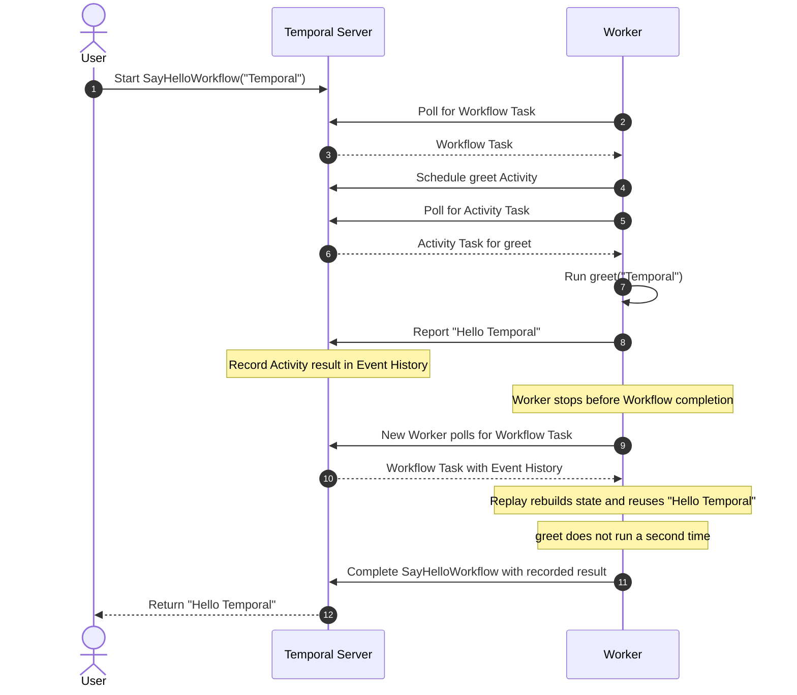

# When Python Jobs Fail: Moving from Retries to Durable Execution

## 1.1: A withdrawal can succeed before a deposit

A simple transaction has two steps: withdraw, then deposit. These function calls strip away Temporal and object models to show the business sequence. If the Worker stops after withdrawal, the process must remember that the first step succeeded before it can safely continue.

```python
# The simple version assumes both calls return normally.
withdrawal_id = act_withdraw(amount="10000.00", currency="IDR")
deposit_id = act_deposit(amount="10000.00", currency="IDR")
```

The sequence is short, but the process can stop between the calls. After restart, ordinary Python memory does not tell the application whether withdrawal completed.

## 1.2: Recovery adds retry and timeout code

The application can retry timeouts with a limited number of attempts, backoff, a timeout for each call, and a deadline for the whole transfer. This helps with temporary failures, but a retry can repeat an operation whose result was uncertain.

**What if a call temporarily fails? How long should we keep retrying?**

```python
from datetime import datetime, timedelta, timezone
from time import sleep


def retry_step(action, deadline):
    for attempt in range(3):
        remaining = (deadline - datetime.now(timezone.utc)).total_seconds()
        if remaining <= 0:
            raise TimeoutError("transfer deadline exceeded")
        try:
            # Bound each service call by five seconds and the shared deadline.
            return action(timeout=min(5, remaining))
        except TimeoutError:
            remaining = (deadline - datetime.now(timezone.utc)).total_seconds()
            if attempt == 2 or remaining <= 0:
                raise
            # Back off between attempts, without sleeping past the deadline.
            sleep(min(2**attempt, remaining))

deadline = datetime.now(timezone.utc) + timedelta(seconds=30)
withdrawal_id = retry_step(
    lambda timeout: act_withdraw(
        amount="10000.00", currency="IDR", timeout=timeout
    ),
    deadline,
)
deposit_id = retry_step(
    lambda timeout: act_deposit(
        amount="10000.00", currency="IDR", timeout=timeout
    ),
    deadline,
)
```

Each step gets at most three attempts with exponential backoff, and the transfer shares a 30-second deadline. The application still needs to record completed steps and prevent duplicate effects after a restart.

## 1.3: Track progress and prevent duplicate effects

To recover after a restart, the application must save progress and allow only the transitions `started → withdrawn → completed`. Stable idempotency keys let the external service recognize a repeated request if an operation succeeded before the application saved its result.

**What if the process restarts after withdrawal? What if withdrawal succeeded, but we never saved its result?**

```python
# Repeat the retry helper to show how the code grows from 1.2.
from datetime import datetime, timezone
from time import sleep


def retry_step(action, deadline):
    for attempt in range(3):
        remaining = (deadline - datetime.now(timezone.utc)).total_seconds()
        if remaining <= 0:
            raise TimeoutError("transfer deadline exceeded")
        try:
            return action(timeout=min(5, remaining))
        except TimeoutError:
            remaining = (deadline - datetime.now(timezone.utc)).total_seconds()
            if attempt == 2 or remaining <= 0:
                raise
            sleep(min(2**attempt, remaining))


# Storage creates status="started" and expires_at on first call, then reloads them.
# load_transfer and save_transfer read and write durable application storage.
state = load_transfer(request_id)
deadline = state["expires_at"]

if state["status"] == "started":
    withdrawal_id = retry_step(
        lambda timeout: act_withdraw(
            amount="10000.00",
            currency="IDR",
            idempotency_key=f"{request_id}:withdraw",
            timeout=timeout,
        ),
        deadline,
    )
    state["withdrawal_id"] = withdrawal_id
    state["status"] = "withdrawn"
    save_transfer(request_id, state)

if state["status"] == "withdrawn":
    deposit_id = retry_step(
        lambda timeout: act_deposit(
            amount="10000.00",
            currency="IDR",
            idempotency_key=f"{request_id}:deposit",
            timeout=timeout,
        ),
        deadline,
    )
    state["deposit_id"] = deposit_id
    state["status"] = "completed"
    save_transfer(request_id, state)
```

The storage helpers are illustrative, and each operation uses its own stable key across retries. If the application crashes after an external operation succeeds but before progress is saved, it can safely repeat that operation only if the external service honors the idempotency key.

| Complexity | Description | How Temporal handles it |
|---|---|---|
| Retry | Retry rules and backoff. | Applies configured Retry Policies. |
| State machine | Track progress and transitions. | Restores state through Event History and Replay. |
| Idempotency | Prevent duplicate effects. | Reuses recorded results; external effects still need duplicate protection. |
| Timeout | Limit attempts and execution time. | Enforces configured timeouts. |
| Troubleshooting | Understand what went wrong. | Shows status and Event History in Temporal UI. |

The Workflow keeps the business sequence to two ordered Activity calls. Temporal records progress and applies configured retries and timeouts, while external Activities still need duplicate protection.

```python
# Inside WfTransfer.run: configure each Activity, then keep the business steps clear.
activity_options = {
    "start_to_close_timeout": timedelta(seconds=30),
    "retry_policy": RetryPolicy(maximum_attempts=3),
}

withdrawal = await workflow.execute_activity(
    act_withdraw,
    WithdrawalInput(transfer.request_id, transfer.amount, transfer.currency),
    **activity_options,
)
deposit = await workflow.execute_activity(
    act_deposit,
    DepositInput(transfer.request_id, transfer.amount, transfer.currency),
    **activity_options,
)
```

The Activity code, Worker setup, and idempotency safeguards still exist, but the Workflow coordinates the transfer with two calls.

## 2.1: Temporal concepts

| Concept | What | Why |
|---|---|---|
| Workflow | Code that defines and coordinates a durable process. | Temporal can preserve progress and resume it after a Worker failure. |
| Activity | A function that performs work outside the Workflow. | External work can fail and be retried independently. |
| Worker | An application process that runs Workflow and Activity code. | Temporal Service schedules work while Workers execute it. |
| Event History | The recorded events and results for a Workflow Execution. | It preserves the source of truth for progress. |
| Replay | Re-running Workflow code against its recorded Event History. | It rebuilds Workflow state and reuses completed Activity results. |

Durable Workflow execution is the combined behavior: Temporal stores progress in Event History, and a Worker uses Replay to reconstruct the Workflow after a failure.

## 2.2: The concepts in Quickstart code

The Quickstart keeps each role small. `greet` is the Activity, `SayHelloWorkflow` calls it, the Worker registers both, and the starter launches the Workflow.

```text
demo/quickstart/
├─ activities.py  # Performs the greeting
├─ workflows.py   # Coordinates the Activity
├─ worker.py      # Registers and runs the Workflow and Activity
└─ starter.py     # Starts the Workflow and prints its result
```

```python
# activities.py: the Activity does the greeting work.
from temporalio import activity


@activity.defn
async def greet(name: str) -> str:
    return f"Hello {name}"
```

```python
# workflows.py: the Workflow coordinates the Activity.
from datetime import timedelta
from temporalio import workflow

with workflow.unsafe.imports_passed_through():
    from activities import greet


@workflow.defn
class SayHelloWorkflow:
    @workflow.run
    async def run(self, name: str) -> str:
        # Schedule the Activity and wait for its result.
        return await workflow.execute_activity(
            greet,
            name,
            schedule_to_close_timeout=timedelta(seconds=10),
        )
```

```python
# worker.py: register the code that this Worker can run.
import asyncio

from temporalio import workflow
from temporalio.client import Client
from temporalio.worker import Worker

with workflow.unsafe.imports_passed_through():
    from activities import greet
    from workflows import SayHelloWorkflow


async def main() -> None:
    # Connect this Worker to the Temporal Server.
    client = await Client.connect("localhost:7233")
    # Register the Workflow and Activity code this Worker can execute.
    worker = Worker(
        client,
        task_queue="my-task-queue",
        workflows=[SayHelloWorkflow],
        activities=[greet],
    )
    # Poll the Task Queue and run tasks as they arrive.
    await worker.run()


if __name__ == "__main__":
    asyncio.run(main())
```

```python
# starter.py: start the Workflow and wait for its result.
import asyncio
import uuid

from temporalio.client import Client

from workflows import SayHelloWorkflow


async def main() -> None:
    # Connect the starter to the Temporal Server.
    client = await Client.connect("localhost:7233")
    # Start the Workflow and wait until it returns a result.
    result = await client.execute_workflow(
        SayHelloWorkflow.run,
        "Temporal",
        id=f"say-hello-workflow-{uuid.uuid4()}",
        task_queue="my-task-queue",
    )
    print("Workflow result:", result)


if __name__ == "__main__":
    asyncio.run(main())
```

The Workflow and Worker must use the same Task Queue name. The greeting is intentionally simple so the roles are easy to see before the transfer demo adds real recovery scenarios.

## 2.3: Replay makes Workflows durable

If a Worker stops after `greet` completes but before the Workflow finishes, Temporal still has the Activity result in Event History. Another Worker replays the Workflow code, uses the recorded greeting, and completes the Workflow without calling `greet` again.



Replay is not retry. Replay rebuilds Workflow state from history; an Activity retry runs the Activity again after a failed attempt. Section 3 applies durable Workflow recovery to the withdrawal and deposit process.

Temporal has more concepts beneath this introduction. This iceberg is a quick map for later exploration, not a section we will explain in detail.

| Level | Concepts | Description |
|---|---|---|
| Upper — 3 | Workflow, Activity, Worker | The application pieces introduced in this talk. |
| Middle — 5 | Event History, Replay, Task Queue, Retry Policy, Timeout | How Temporal records progress, dispatches work, and handles failures. |
| Lower — 7 | Workflow Task, Activity Task, Command, Event, Timer, Signal, Workflow Run ID | Execution and history details to explore after the talk. |

Use the iceberg as a bridge from the basic concepts to the hands-on transfer demos.

## 3.1: Crash the Worker between Activities

Start the Temporal Service before the talk with `./demo/start_server.sh`. It uses the persistent `demo/temporal.db` file and serves the UI at `http://localhost:8233`.

```text
demo/
├── start_server.sh                  # Start Temporal Service and UI
└── transfer/
    ├── activities.py                # Dummy withdrawal and deposit Activities
    ├── workflows.py                 # WfTransfer sequence and retry settings
    ├── worker.py                    # Registers the Workflow and Activities
    ├── starter.py                   # Starts a uniquely identified Workflow
    ├── demo_lib.sh                  # Shared process and log helpers
    ├── demo_worker_crash.sh         # Stops and restarts the Worker
    ├── demo_activity_retry.sh       # Fails deposit twice, then succeeds
    ├── demo_ui_reset.sh             # Exhausts retries and guides UI Reset
    └── README.md                    # Script instructions and timing
```

Run `./demo/transfer/demo_worker_crash.sh`. The script starts a Workflow with an 8-second pause after withdrawal, stops its Worker, waits through the timer, and starts a new Worker. The same Workflow Run should complete with deposit, reusing the recorded withdrawal result.

## 3.2: Let an Activity retry and succeed

Run `./demo/transfer/demo_activity_retry.sh`. The script creates a temporary failure marker that causes the deposit Activity to fail twice; the third attempt succeeds because `maximum_attempts=3` includes the initial attempt.

| Scope | Demo setting | What it means |
|---|---|---|
| Workflow retry | Disabled | A failed Workflow does not automatically start another Run. |
| Workflow Task timeout | 10 seconds | Temporal reschedules a Workflow Task if its Worker does not respond in time. |
| Workflow Execution timeout | 1 hour | The overall Workflow Execution has a one-hour deadline. |
| Activity retry | Maximum 3 attempts | Each Activity can run once, then retry up to two times. |
| Activity timeout | 30-second Start-To-Close | Each Activity attempt has up to 30 seconds to finish. |

Point out the three attempts in the UI and the final Activity result. The script prints the Workflow ID and clears its temporary marker and logs when it exits.

## 3.3: Fix the Activity code and Reset

Run `./demo/transfer/demo_ui_reset.sh`. It starts the Workflow with amount `"0.00"`, which triggers a marked guard in `act_deposit`. All three attempts fail, so the Workflow closes as Failed because its code does not handle the exhausted Activity failure.

The script stops its Worker and prompts you to comment out the `if request.amount == "0.00":` guard and its `raise ApplicationError` block. After you save the edit, the script restarts the Worker to load the fixed Activity code. In Temporal UI, choose Reset and select Event ID `10` (`WorkflowTaskCompleted`), after withdrawal completed and before deposit ran.

Add a reason and confirm Reset, then press Enter in the terminal. The new Run preserves the completed withdrawal and retries deposit using the updated Activity code. Show the changed Run ID and completed deposit result. Restore the guard before rehearsing this scenario again.
